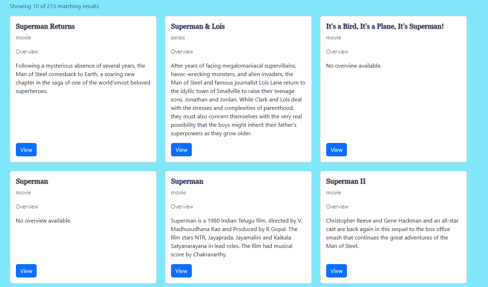
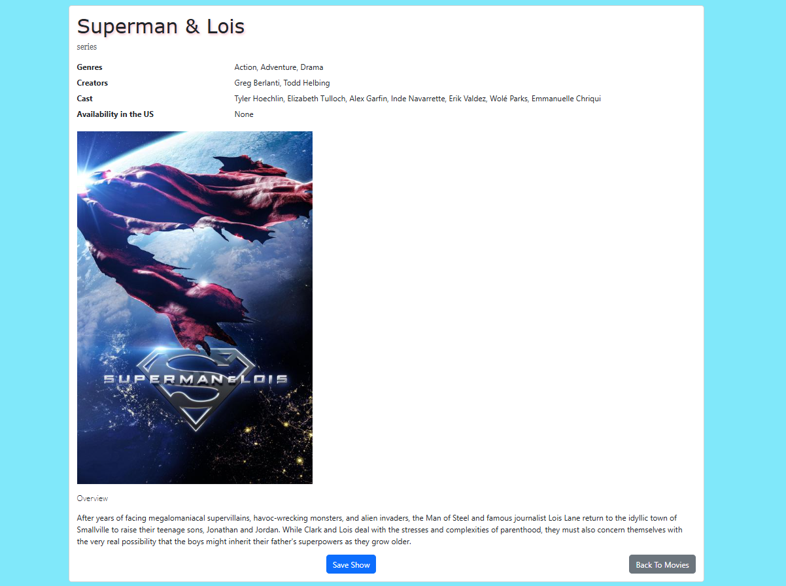
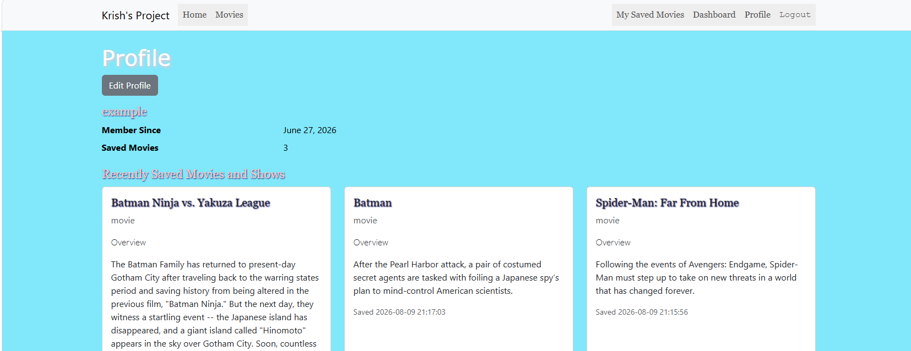

# 🎬 Movie Savior

### A Full-Stack Movie Discovery & Bookmarking Platform

Movie Savior is a full-stack web application that allows users to discover movies, explore available streaming information, and bookmark movies through an interactive interface.

Built using **PHP, MySQL, JavaScript, and Bootstrap**, the application combines database-driven functionality, external API integration, user authentication, and role-based authorization.

This project was developed as part of my coursework at the **New Jersey Institute of Technology (NJIT)**.

---

## ✨ Key Features

- **Movie Discovery:** Browse movies through an interactive movie discovery interface.
- **Movie Bookmarking:** Save and manage movies using database-backed functionality.
- **CRUD Operations:** Perform Create, Read, Update, and Delete operations using PHP and MySQL.
- **User Authentication:** Support user authentication and account-related functionality.
- **Role-Based Authorization:** Restrict application functionality based on user roles.
- **External API Integration:** Retrieve movie-related streaming information using the Streaming Availability API.
- **API Response Caching:** Store parsed API responses in MySQL to reduce repeated external API requests.
- **Error Handling:** Handle unsuccessful external API requests.
- **Application Security:** Implement server-side input validation and CSRF protection.

---

## 🛠️ Technology Stack

| Category | Technologies |
|---|---|
| Backend | PHP |
| Frontend | HTML, CSS, JavaScript |
| UI Framework | Bootstrap |
| Database | MySQL |
| API Integration | REST APIs, PHP cURL |
| Database Access | PDO / MySQL |
| Containerization | Docker |
| Version Control | Git, GitHub |

---

## 🏗️ Application Architecture

Movie Savior follows a full-stack architecture connecting the frontend, backend application logic, database, and external API services.

### 1. Frontend

- HTML and CSS for application structure and styling.
- JavaScript for interactive functionality.
- Bootstrap for responsive layouts and UI components.

### 2. Backend

- PHP handles server-side application logic.
- Database-driven CRUD operations manage application data.
- Authentication and role-based authorization control access.
- Server-side validation processes user input.
- PHP cURL handles communication with external APIs.

### 3. Database

- MySQL provides persistent data storage.
- Database operations support movie management and bookmarking.
- Parsed JSON API responses are stored for caching and subsequent retrieval.

### 4. External API Integration

- Integrates the Streaming Availability API to retrieve movie-related streaming information.
- Uses PHP cURL to communicate with the external service.
- Processes JSON responses and stores relevant data in MySQL.

---

## 🔐 Security Considerations

Security was an important consideration throughout development.

The application incorporates:

- **Authentication:** User authentication functionality.
- **Authorization:** Role-based access control.
- **CSRF Protection:** Protection against Cross-Site Request Forgery.
- **Input Validation:** Server-side validation of user-submitted data.
- **API Error Handling:** Handling unsuccessful external service requests.

---

## 📸 Application Screenshots

Screenshots provide a visual overview of Movie Savior's interface and functionality.

### Homepage


### Movie Discovery



### Movie Details and Bookmarking



### User Interface



---

## ⚙️ Installation and Setup

### Prerequisites

Before running the application, ensure you have:

- PHP 8.x with the required extensions
- MySQL
- Apache or another compatible PHP web server
- Git
- A Streaming Availability API credential, if required by your configuration

### 1. Clone the Repository

```bash
git clone https://github.com/GitRunner47/Movie-Savior.git
```

### 2. Navigate to the Project Directory

```bash
cd Movie-Savior
```

### 3. Configure the Database

- Create a MySQL database.
- Locate the SQL schema in the `sql/` directory.
- Import the appropriate SQL files into your database.
- Configure the database connection using the application's existing configuration structure.

### 4. Configure External API Access

Configure the required Streaming Availability API credentials according to the application's configuration.

Avoid committing API keys, database passwords, or other sensitive credentials to version control.

### 5. Start the Application

Configure your PHP-compatible web server to serve the `public_html/` directory as the document root.

Open the application in your browser using your configured local server address.

**Docker:** The repository also includes a Dockerfile for building the PHP/Apache application container. The MySQL database must be configured separately.

---

## 🧠 Technical Skills Demonstrated

Developing Movie Savior provided practical experience with:

- Full-stack web application development.
- Server-side programming using PHP.
- Relational database design and MySQL.
- Database-driven CRUD operations.
- Authentication and role-based authorization.
- REST API integration and HTTP requests.
- JSON parsing and API response caching.
- Application security and server-side validation.
- Application architecture and project organization.

---

## 🚀 Potential Future Improvements

- Implement automated backend testing.
- Improve database query performance.
- Expand application functionality and movie filtering.
- Enhance the user experience and responsive design.
- Improve API caching strategies and error handling.
- Add automated deployment and continuous integration.

---

## 📄 License

This project is licensed under the MIT License. See the [LICENSE](LICENSE) file for details.

---

## 👨‍💻 Author

**Krish Viradia**

Computer Science Undergraduate  
New Jersey Institute of Technology (NJIT)

- GitHub: [@GitRunner47](https://github.com/GitRunner47)
- LinkedIn: [Krish Viradia](https://www.linkedin.com/in/krish-viradia/)

---

*Developed as a full-stack web development project at NJIT.*
